<picture>
  <source media="(prefers-reduced-motion: reduce)" srcset="assets/shipping-harbor/shipping-harbor-static.png" />
  
</picture>

<picture><source media="(prefers-color-scheme: light)" srcset="assets/headings/projects-light.svg" /></picture>

<a href="https://github.com/harishkumar04/End-to-End-Devops-Pipeline"><picture><source media="(prefers-color-scheme: light)" srcset="assets/projects/devops-pipeline-light.svg" /></picture></a>
<a href="https://github.com/harishkumar04/Jenkins-RCA-Agent"><picture><source media="(prefers-color-scheme: light)" srcset="assets/projects/jenkins-rca-agent-light.svg" /></picture></a>
<a href="https://github.com/harishkumar04/RAG-Chatbot-using-AWS-Bedrock"><picture><source media="(prefers-color-scheme: light)" srcset="assets/projects/rag-chatbot-bedrock-light.svg" /></picture></a>

<picture><source media="(prefers-color-scheme: light)" srcset="assets/headings/contributions-light.svg" /></picture>

<!-- skyline:start -->

<!-- skyline:end -->

<picture><source media="(prefers-color-scheme: light)" srcset="assets/headings/connect-light.svg" /></picture>

<a href="https://www.linkedin.com/in/r-harish-kumar"><picture><source media="(prefers-color-scheme: light)" srcset="assets/contact/linkedin-light.svg" /></picture></a>
<a href="mailto:rharish0909@gmail.com"><picture><source media="(prefers-color-scheme: light)" srcset="assets/contact/email-light.svg" /></picture></a>
<a href="https://drive.google.com/file/d/1EkubQ4wFilWgiNlZ-Dxq8VVNMLBR9j-C/view?usp=sharing"><picture><source media="(prefers-color-scheme: light)" srcset="assets/contact/resume-light.svg" /></picture></a>
